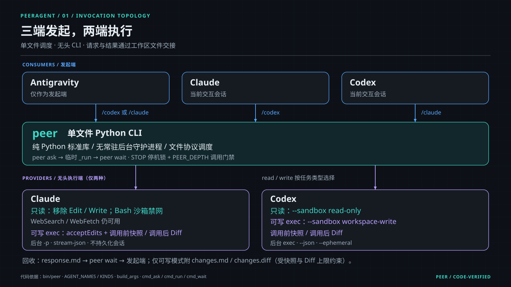
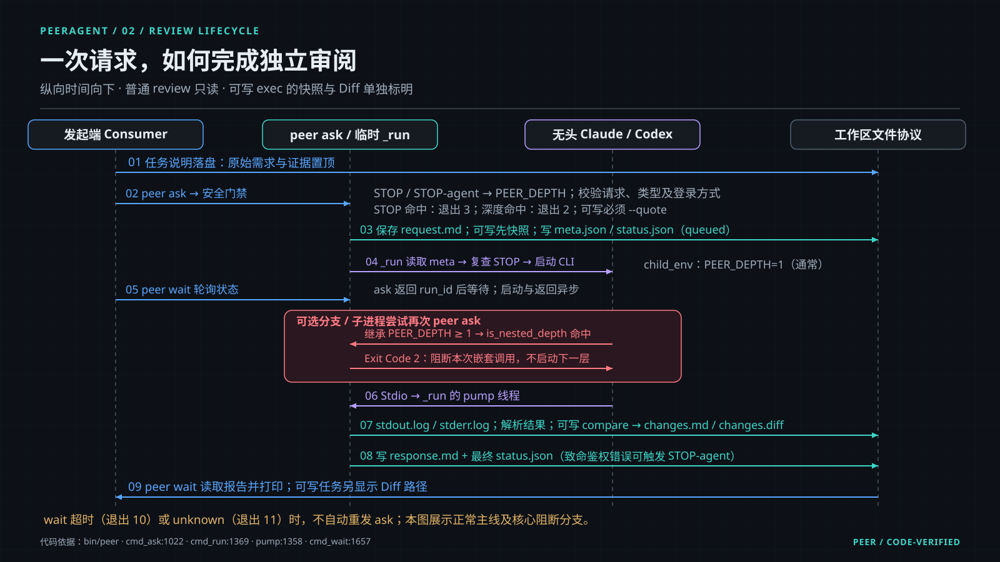
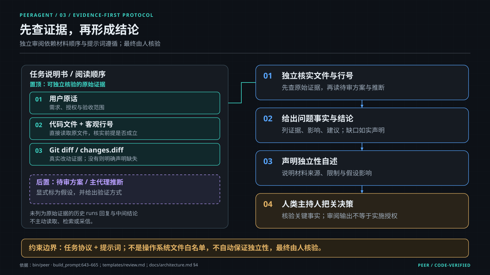

# PeerAgent 🤝

> **让 Claude 与 Codex 帮彼此审代码 —— 查验真实事实，拒绝盲目附和。**  
> *专为开发者打造的轻量级、订阅原生、跨模型对等交叉审阅 CLI。*

[](https://github.com/puck-muling/peer-agent/actions/workflows/ci.yml)
[](https://opensource.org/licenses/MIT)
[](https://www.python.org/downloads/)
[-brightgreen.svg)](./bin/peer)
[](./README.md)
[](https://github.com/puck-muling/peer-agent)

[English Document (README_EN.md)](./README_EN.md) | [安全模型 (SECURITY.md)](./SECURITY.md) | [架构设计详解 (architecture.md)](./docs/architecture.md) | [贡献指南 (CONTRIBUTING.md)](./CONTRIBUTING.md) | [版本历史 (CHANGELOG.md)](./CHANGELOG.md)

---

如果你平时在用 **Claude**，**Codex**，**Antigravity** 这几个程序写代码，你一定经历过这些痛点：
* 每次让 AI 写完一大段代码，心里总打鼓：“这里面会不会漏了边界条件，或者有隐蔽的 Regression Bug？”
* 想让另一个大模型帮忙挑刺把关，只能痛苦地**复制代码 → 切换窗口 → 粘贴发问 → 再把结论搬回来**，来回折腾好几轮；
* 现有的多智能体框架通常需要配置商业 API Key，跑一次交叉审阅产生昂贵的按 Token 计费账单，无法复用已有会员订阅。

**装上 PeerAgent 之后，就像把另一个顶级 AI 程序员请到了你的当前终端里：**

### 在当前终端一句话唤起交叉审阅

在 **Claude** 会话中：
```text
❯ /codex 审阅当前 git diff，重点排查并发竞争与边界条件
```

几秒后，后台无头运行的 **Codex** 原地返回独立审阅报告（只读沙箱，物理禁止修改任何文件）：
```markdown
# Codex · 审阅（只读）

- 状态：完成
- 模型：gpt-6.1-sol
- 强度：high
- 登录方式：subscription（Logged in using ChatGPT）
- 服务提供方：官方

## 回复

[src/api.py:42] 发现潜在并发竞争：
多线程写入 cache 文件时未获取排他锁，高并发下可能导致写入冲突。
建议：使用 fcntl.flock 保护文件写入或改用原子写入。
```

同理，在 **Codex** 终端中输入 `/claude`，即可呼叫 Claude 进行代码与方案复核。

---

## 为什么使用 PeerAgent？

| 考量维度 | 传统手动转交 | 商业 API 框架 (LangGraph / CrewAI) | PeerAgent |
| :--- | :--- | :--- | :--- |
| **交互流程** | 复制代码、切换标签页、粘贴发问、整理结论 | 需配置复杂编排脚本或常驻服务 | **当前终端一条斜杠命令，结果原地返回** |
| **计费方式** | 官方订阅（人工繁琐操作） | 需配置 API Key，按 Token 商业计费 | **本机官方 CLI 原生直驱，复用已有会员额度** |
| **环境依赖** | 无 | 依赖多个重量级第三方包 | **单文件 Python CLI，仅依赖纯标准库** |
| **防死循环机制** | 人工干预 | 仅依靠轮次上限限制 | **`PEER_DEPTH` 进程染色，子进程嵌套调用物理退出（退出码 2）** |
| **安全风控机制** | 无 | 通常依赖代码异常抛出 | **物理 `STOP` 停机锁，禁止 AI 自动恢复，保护账号安全** |

---

## 两项可核验的安全承诺

1. **纯标准库零外部依赖**：核心调度器 [`bin/peer`](./bin/peer) 为单文件实现，仅 import Python 官方标准库，无需 `pip install` 任何第三方包。
2. **绝不意外产生 API 账单**：每次调用前强制核对登录状态与已确认方式（默认 `subscription` 会员订阅）。一旦检测到未确认的变动，直接终止调用并提示退出（退出码 3），必须由人类执行 `peer doctor --approve` 确认后方可继续。

---

## 安装与上手

> [!TIP]
> **前置要求**：Python 3.10+（纯标准库，无需 pip 安装三方包）。并确保你常用的工具（Claude、Codex 或 Antigravity）中至少已安装并登录一个即可。

### 0. 准备官方 CLI（按需安装）
若需要调用对应模型，请确保本机已全局安装官方 CLI 并登录：
```bash
# Claude 官方 CLI
npm install -g @anthropic-ai/claude-code
claude login

# OpenAI Codex 官方 CLI
npm install -g @openai/codex
codex login
```

### 1. 一键安装
```bash
git clone https://github.com/puck-muling/peer-agent.git
cd peer-agent && ./install.sh
```

### 2. 环境与认证自检
```bash
peer doctor
```

### 3. 马上体验
在你的 **Claude** 终端中输入：
```text
/codex 审阅当前 git diff，重点排查异常边界。只读审阅，不要修改任何文件。
```

---

## 典型使用场景

* **代码提交前查回归**（在 Claude 中）：
  ```text
  /codex 审阅当前 git diff，重点排查权限校验、并发与异常边界
  ```
* **重构后查调用方遗漏**（在 Codex 中）：
  ```text
  /claude 检查所有调用方是否已正确适配新模块的返回值
  ```
* **方案实施前核真伪**（在 Antigravity 中）：
  ```text
  /codex 先独立核实方案中引用的代码文件与行号是否属实，再评估可行性
  ```

---

## 系统架构与工作原理

<details>
<summary><b>点击展开：调用拓扑、审阅时序与证据优先协议</b></summary>



* **三端发起，两端执行**：Antigravity、Claude 和 Codex 均可作为交互发起端；实际无头执行端为本机安装的 Claude 与 Codex。单文件 `peer` 使用 Python 标准库与工作区文件协议调度，无常驻后台守护进程。



* **时序与防递归机制**：任务先落盘并经过 STOP 停机锁与 PEER_DEPTH 门禁；元数据写入后，临时后台 `_run` 启动无头 CLI、捕获 Stdio 并生成报告。子进程尝试二次调用时，继承的深度标记触发退出码 2 立即拦截。



* **证据优先独立审阅**：任务书排版先列用户原话、代码行号与真实 Git Diff，再列待审假设。审阅者先独立核验客观证据，再给出事实、结论与独立性自述，最终由人类主持人核验决策。

详细系统设计请阅读 [架构设计文档 (docs/architecture.md)](./docs/architecture.md)。
</details>

<details>
<summary><b>命令行直接调用方式 (CLI Reference)</b></summary>

```bash
# 1. 运行自检
peer doctor

# 2. 发起异步只读审阅
peer ask codex review --request ./task.md --cwd .

# 3. 轮询等待并收取报告
peer wait <run_id> --cwd .

# 4. 查看当日调用统计与 Token 用量
peer stats
```
</details>

---

## 社区与交流 (Community)

关注作者 X (Twitter) 或加入 Telegram 交流群探讨多 Agent 落地实战：

<p align="center">
  <a href="https://x.com/puck_muling"><b>Twitter (@puck_muling)</b></a> &nbsp;·&nbsp; 
  <a href="https://t.me/puckmuling"><b>Telegram (@puckmuling)</b></a>
</p>

<p align="center">
  
</p>

---

## 许可证与安全

本项目采用 [MIT 许可证](./LICENSE) 开源。  
安全模型声明与漏洞报告指引详见 [SECURITY.md](./SECURITY.md)。
