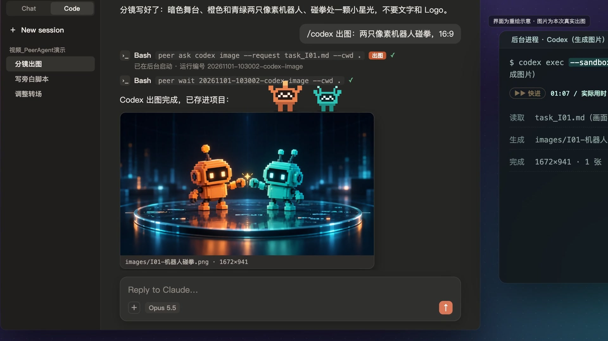
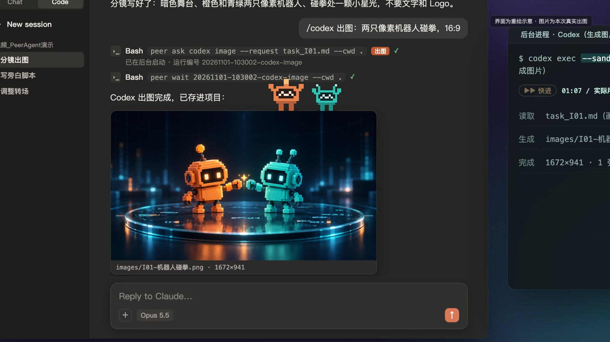
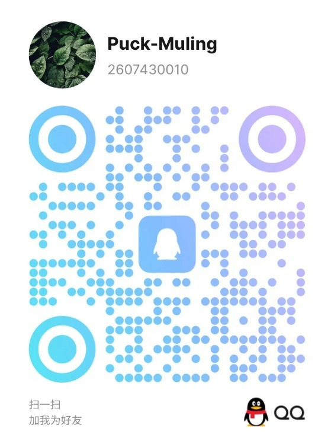

<div align="center">

**简体中文** | [English](README_EN.md)

# PeerAgent 🤝

**让 Claude Code 和 Codex 互相审代码，少一次复制粘贴，多一份独立意见。**

在当前会话里请另一个模型检查代码，审阅意见直接带回来，省去切窗口和搬运结果。

使用本机官方 CLI · 支持已有订阅登录 · 审阅任务只读 · 核心无需 Python 第三方包

[安装与初次体验](#安装与初次体验) · [使用示例](#使用示例) · [费用与权限边界](#费用与权限边界) · [常见问题与网络排障](#常见问题与网络排障)

[](https://github.com/puck-muling/peer-agent/actions/workflows/ci.yml)
[](./LICENSE)
[](https://www.python.org/downloads/)

</div>

## 演示视频

<a href="https://cdn.jsdelivr.net/gh/puck-muling/peer-agent@main/docs/assets/demo.mp4"></a>

▶ [观看演示视频](https://cdn.jsdelivr.net/gh/puck-muling/peer-agent@main/docs/assets/demo.mp4)（2 分 21 秒，中文旁白与字幕）

适合已经使用 Claude Code 或 Codex、想让另一个模型多检查一遍的开发者。需要 **Python 3.10+ 和被调用模型对应的官方 CLI**；订阅登录仍会消耗对应额度，实际计费取决于登录方式和所用工具。安装面向 macOS / Linux；Windows 原生及 WSL 尚无本项目的完整验证记录。

## 安装与初次体验

### 先确认你要从哪里调用

| 使用方式 | 需要准备什么 |
| :--- | :--- |
| 在 Claude Code 会话中输入 `/codex` | 可用的 Claude Code 会话，以及本机已安装、已登录的 Codex CLI |
| 在 Codex 会话中调用 `/claude` 技能 | 可用的 Codex 会话，以及本机已安装、已登录的 Claude Code CLI |
| 在 Antigravity 中调用任一模型 | Antigravity 主持环境，以及被调用模型对应的官方 CLI 和登录状态 |
| 直接用 `peer ask` 调用 | Python 3.10+，以及被调用模型对应的官方 CLI 和登录状态 |

PeerAgent 不替你安装或登录这些 CLI。按需准备后，先确认目标 CLI 能单独运行，再安装 PeerAgent；无需为了单向调用而开通另一条不用的调用渠道。

### 30 秒上手命令

以下是已具备前置环境时的安装入口，下载和首次调用耗时取决于网络与任务大小：

```bash
git clone https://github.com/puck-muling/peer-agent.git
cd peer-agent
./install.sh
peer doctor
```

安装默认采用**文件复制**：将 `peer` 复制到 `~/.local/bin/peer` 和 `$PEER_HOME/bin/peer`（`PEER_HOME` 默认是 `~/.peer-review`），并复制模板与各端技能；配置不存在时生成默认配置，还会按 Shell 情况补充 PATH。开发时可显式选择 `./install.sh --link` 使用软链接。复制安装后，修改仓库不会自动更新已安装副本。

如果当前终端还找不到 `peer`，可先用固定路径检查：

```bash
"$HOME/.local/bin/peer" doctor
```

`peer doctor` 用于查看 CLI 位置、登录类别和配置等信息。**不要把 `peer doctor --approve` 当作通用修复命令**：它会把当前可识别的登录类别写入批准配置，可能涉及两条调用渠道；请先核实输出和计费方式。

### 发起第一次审阅

安装技能后，重新打开或刷新主持端客户端，确认技能已加载。进入你要审阅的项目，在 **Claude Code** 中输入：

```text
/codex review 审阅当前 git diff，重点检查异常边界。只读，不要修改文件。
```

在 **Codex** 中可调用 `/claude` 技能（具体入口以客户端技能菜单为准）：

```text
/claude review 审阅当前 git diff，检查旧功能是否受影响。只读，不要修改文件。
```

下面仅展示可能返回的内容格式，**不是历史任务的原始报告**；路径和行号为示意，实际发现与耗时取决于任务：

```markdown
## 审阅意见（示意）

- 位置：src/handler.py:42（示意）
- 问题：失败分支没有关闭资源，可能导致重复请求后连接耗尽。
- 待验证：检查调用方是否负责释放，并运行覆盖失败分支的测试。
```

报告回来后先核查问题位置和触发条件，再决定是否修改。另一个模型也可能漏查或判断错误。

## 使用示例

| 你想做什么 | 可以怎么说或怎么调用 |
| :--- | :--- |
| 请 Codex 检查改动 | `/codex review 审阅当前 git diff，检查并发和异常边界。只读。` |
| 请 Claude 看重构方案 | `/claude plan 根据当前模块提出重构方案，不要修改文件。` |
| 批准一个具体修复 | `/codex exec 授权修改：修复刚才确认的资源释放问题，仅改对应函数。` |
| 生成图片（仅 Codex） | `/codex image 授权生成：画一张调用流程图，保存到项目指定素材目录。` |
| 保存方案版本和内容指纹 | `peer freeze ./方案-v2.md --cwd .` |
| 检查环境 | `peer doctor` |

### 审阅、方案和执行怎么区分

斜杠技能按关键词判断意图，属于启发式路由，并不能理解所有自然语言表达。下面的匹配顺序对应 **Claude Code 中的 `/codex` 技能**：

1. 开头明确写 `exec` / `review` / `plan` / `advice` / `image` 时按该类型处理；显式 `exec` 遇到只读或禁止修改要求会降级为 `review`。
2. 未显式指定时，否定词和审阅词优先于修改词。例如“审阅当前修改”“检查修复结果”按 `review` 处理。
3. 随后依次匹配方案词、出图词、修改词和建议词；未命中时默认 `review`。

Codex 中的 `/claude` 和 Antigravity 技能使用不同的分类规则，不能假定各端优先级完全相同；以对应技能和实际调用类型为准。需要确定类型时，可直接用 `peer ask` 传入，不经过斜杠技能的意图判断。

`review`、`plan`、`advice` 采用只读执行配置；`exec`、`image` 可写，需要用户授权原话。请写清允许修改哪些文件，并核对发起的任务类型。

### 在终端直接调用

先在项目中准备任务说明文件 `review-task.md`，写清要检查的文件、原始需求和回复要求，例如：

```markdown
# 任务

只读审阅当前 git diff，重点检查异常处理。不要修改文件。

## 回复格式

列出问题位置、触发条件、依据和仍需验证的事项；没有发现也请明确说明。
```

然后调用对应 CLI：

```bash
peer ask codex review --request ./review-task.md --cwd .
```

命令默认后台运行，返回运行编号。将下面的 `RUN_ID` 替换成该编号：

```bash
peer wait RUN_ID --cwd .
peer status RUN_ID --cwd .
peer stats
```

`peer wait` 等待超时只表示还没有等到结果，应查询或继续等待原编号；不要重新 `ask`。

可写任务使用单独的任务说明，并传入用户已经确认的授权原话：

```bash
peer ask codex exec --request ./fix-task.md --cwd . \
  --quote '仅修复已确认的资源释放问题'
```

程序只检查 `--quote` 是否非空，不会判断这段话是否充分授权了每项操作。修改前快照位于 `.peer-review/runs/<运行编号>/snapshot/`，完成后生成 `changes.md` 和 `changes.diff`；快照限制见下文。

### Antigravity 主持双方审阅

可以分别请 Claude 和 Codex 核查相同的源码和需求，再由主持端汇总问题位置、证据和分歧。任务说明要求先查原始证据，避免直接采信已有结论；**这不是操作系统级的盲审隔离**。请求正文会直接传给被调用方，主持端应避免把另一方结论混入独立审阅请求。

方案经人确认后，可保存冻结副本：

```bash
peer freeze ./方案-v2.md --cwd .
peer verify ./方案-v2_冻结v001.md
peer since-freeze ./方案-v2_冻结v001.md
```

示例假定这是该文档的第一次冻结，实际文件名以输出为准。`freeze` 创建 `*_冻结vNNN.md`、内容指纹、项目快照与交接语；默认是独立模式。可选的 `--review-receipt <目录>` 会校验外部终审回执；未提供回执时，冻结本身不代表已获批准。SHA-256 用于检查内容是否变化，不会阻止文件被编辑，也不是实施授权。

<details>
<summary>完整命令索引</summary>

| 命令 | 参数与说明 |
| :--- | :--- |
| `peer doctor` | `[--approve]`：检查环境；显式批准时记录当前可识别的登录类别 |
| `peer ask <codex\|claude> <kind>` | `--request <文件> --cwd <目录>`；`kind` 为 `review` / `plan` / `advice` / `exec` / `image`，其中 `image` 仅 Codex 支持 |
| 调用可选参数 | `--quote <原话>`、`--model <模型>`、`--effort <强度>`、`--service-tier <层级>`、`--add-dir <目录>`、`--caller <名称>`、`--foreground`；可写类型必须有 `--quote` |
| `peer wait <运行编号>` | `--cwd <目录> [--timeout <秒>]`：等待原任务并显示报告 |
| `peer status [运行编号]` | `--cwd <目录>`：查看某次任务或最近 10 次任务 |
| `peer freeze <方案文档>` | `--cwd <目录> [--quote <原话>] [--review-receipt <目录>]`：保存冻结副本与指纹 |
| `peer verify <冻结版文件>` | 比较冻结副本与记录的 SHA-256 |
| `peer since-freeze <冻结版文件>` | 比较项目与冻结时快照，并生成改动记录 |
| `peer stats` | 显示当日调用与可取得的用量统计；不等同于官方账单 |

</details>

## 费用与权限边界

| 机制 | 实际做什么 | 需要知道的限制 |
| :--- | :--- | :--- |
| 登录类别检查 | 调用前比较当前类别与 `approved_auth`，不一致时停止，退出码 3 | 不能验证授权范围、可用余额或最终账单。支持已有 CLI 订阅登录，仍消耗额度；API 登录按相应规则计费 |
| 只读任务 | 给 Codex 设置 `read-only` 沙箱；给 Claude 限制工具和 Bash 沙箱权限，并在任务说明中要求只读 | 依赖目标 CLI 与系统沙箱实现；PeerAgent 仍会写入任务、日志等过程文件，不代表整台机器不写文件 |
| 可写授权 | `exec` / `image` 要求非空授权引文，使用可写配置 | 引文存在不等于程序理解了授权；实施范围仍需人和执行方核对 |
| 改前快照 | 保存可复制的文本内容并记录文件信息，改后对比 | 跳过部分目录和疑似敏感内容；大文件、二进制与总量等有限制，不是完整备份或自动回滚 |
| 防递归标记 | 子进程继承 `PEER_DEPTH` 后，嵌套 `peer ask` 被拒绝，退出码 2 | 只覆盖经过该入口且保留标记的调用，不能阻止所有可能的模型循环 |
| STOP 文件 | 检测到特定封禁或地区错误后，阻止该渠道的后续调用 | 依赖错误匹配，不能保证避免封号；需人工排查，Agent 不应自动删除 STOP 文件 |
| 独立审阅要求 | 提示审阅者先查源码、需求和 diff，再判断主张 | 不保证模型意见正确、互不影响或必然达成共识 |

快照默认跳过 `.git`、`node_modules`、`.peer-review` 等目录。单个文本文件超过 2 MiB 不复制，超过 64 MiB 的文件只记录大小和修改时间；复制总量上限 300 MiB，文件数上限 40,000。具体规则见 [`bin/peer`](./bin/peer)，完整权限说明见 [SECURITY.md](./SECURITY.md)。

## 常见问题与网络排障

### 找不到 `peer` 或目标 CLI

重开终端使 PATH 生效，或使用前面的 `~/.local/bin/peer` 固定路径。目标模型仍提示找不到命令时，确认对应 CLI 已安装，且启动主持端的环境能找到它；必要时将配置的 `bins.claude` / `bins.codex` 改为实际可执行文件的绝对路径。PATH 或配置改完后，重启主持端再检查。

### 未登录，或提示登录类别不一致

先在原渠道的官方 CLI 中核实登录状态；未登录时按该 CLI 的流程登录，再运行 `peer doctor`。若你有意改变了登录方式，先确认订阅/API 与计费预期，再由本人决定是否执行 `peer doctor --approve`。它记录可识别的当前类别，不修复网络、额度或账号权限。

### 安装了，但 `/codex` 或 `/claude` 没出现

刷新或重开主持端，检查技能是否加载到了该客户端实际使用的配置目录。安装器复制到默认的 Claude、Codex 和 Antigravity 技能目录；使用自定义配置目录时，需要按客户端设置核对。斜杠菜单的显示方式以客户端版本为准，也可先用 `peer ask` 排查调度链路。

### 国内网络下，代理端口能连但请求仍失败

`proxy_check` **只用 TCP 连接探测指定的主机和端口**，不自动设置代理，也不检查 HTTP/SOCKS 协议、认证、DNS、TLS 或官方模型服务是否可达。可以按本机实际端口配置：

```json
{
  "proxy_check": ["127.0.0.1", 7890]
}
```

这仅让 `peer doctor` 检查端口。代理地址、协议和环境变量要在运行官方 CLI 的环境中另行配置；子进程会继承环境，但目标 CLI 是否采用这些设置取决于它自身的实现。先在同一终端验证官方 CLI 的网络状态，再检查主持端是否继承相同环境。代理软件启用了，不代表从桌面打开的客户端也拿到了终端环境变量。

CLI 安装包下载与模型服务访问是两条链路。安装成功不代表模型服务可达；遇到代理超时，先检查端口、协议和目标服务。这里不提供未经验证的镜像或绕过服务限制的方案。

### 任务超时，或状态是 `unknown`

先用原运行编号执行 `peer status`，检查该任务目录中的状态、报告和错误文件；等待超时可继续 `peer wait`。`unknown` 表示进程已结束但结果没有回收，不代表请求未提交。结果不明时不要重发或切账号；先核查原任务和原账号，确认未受理并获得重试授权后再发新请求。PeerAgent 不自动重试。

### 模型或强度不受支持

默认模型留空并跟随客户端设置；配置中 Codex 强度默认固定为 `high`。指定模型、强度前先确认目标 CLI 支持。优先级为：本次参数 > 配置固定值 > 客户端设置 > CLI 默认值。PeerAgent 接受参数不代表目标服务一定支持。

## 配置参考

默认配置位于 `~/.peer-review/config.json`，也可用 `PEER_CONFIG` 指向其他文件。完整默认值如下，字段与 [`config.example.json`](./config.example.json) 一致：

```json
{
  "bins": {
    "claude": "claude",
    "codex": "codex"
  },
  "models": {
    "claude": "",
    "codex": ""
  },
  "efforts": {
    "claude": "",
    "codex": "high"
  },
  "service_tiers": {
    "codex": "default"
  },
  "follow_app_settings": true,
  "approved_auth": {
    "claude": "subscription",
    "codex": "subscription"
  },
  "max_turns": {
    "read": 20,
    "write": 120
  },
  "timeout_minutes": {
    "read": 30,
    "write": 60
  },
  "proxy_check": null,
  "codex_disable_apps": false
}
```

| 配置项 | 说明 |
| :--- | :--- |
| `bins` | 目标 CLI 命令名或绝对路径 |
| `models` | 固定模型；空字符串表示尝试跟随客户端，不写死模型名称 |
| `efforts` | 固定推理强度；空字符串表示尝试跟随客户端，具体取值由目标 CLI 支持情况决定 |
| `service_tiers.codex` | 当前调度器只接受 `default` 或 `flex`；默认 `default` |
| `follow_app_settings` | 允许在对应配置留空时读取客户端设置 |
| `approved_auth` | 已批准的登录类别，默认均为 `subscription`；不一致时阻止调用 |
| `max_turns` | 当前用于 Claude CLI 的最大轮次参数，不是两端通用的循环保证 |
| `timeout_minutes` | 读/写任务最长运行时间（分钟），到期终止子进程；不证明远端未处理请求 |
| `proxy_check` | 可选 `[主机, 端口]` TCP 检测，不配置代理 |
| `codex_disable_apps` | 传参禁用 Codex Apps；默认 `false`，生图任务会单独禁用 |

如果只想固定高强度、继续跟随模型设置，可合并下面的配置片段：

```json
{
  "efforts": {"claude": "high", "codex": "high"}
}
```

若主动改用官方 API 登录，先在对应 CLI 完成并确认，再核对 `peer doctor` 输出后决定是否批准新类别；不要仅为了消除报错而批准。

### 环境变量

| 环境变量 | 默认值与用途 |
| :--- | :--- |
| `PEER_HOME` | 默认 `~/.peer-review`，存放配置、模板和全局调用日志 |
| `PEER_CONFIG` | 默认 `$PEER_HOME/config.json`，指定配置文件 |
| `PEER_TEMPLATES_DIR` | 覆盖模板目录；默认优先程序所在仓库的 `templates/`，否则用 `$PEER_HOME/templates` |
| `PEER_DEPTH` | 默认 0，由调度器为子进程增加深度标记，用于拒绝嵌套调用 |
| `HTTP_PROXY` / `HTTPS_PROXY` / `ALL_PROXY` | 继承启动环境中的值；是否生效由目标 CLI 决定，PeerAgent 不自动设置 |

## 里面有什么与工作原理

| 组成 | 路径与说明 |
| :--- | :--- |
| 核心调度器 | [`bin/peer`](./bin/peer)，当前版本 2,028 行，仅用 Python 标准库，无常驻守护进程 |
| CLI 适配技能 | [`skills/`](./skills/)，适配 Claude Code、Codex 与 Antigravity，非这些厂商官方出品 |
| 任务模板 | [`templates/`](./templates/)，共 5 份：`review.md`、`plan.md`、`advice.md`、`exec.md`、`image.md` |
| 安装器 | [`install.sh`](./install.sh)，默认文件复制，可显式选择软链接 |
| 测试 | [`tests/`](./tests/)，核心行为的测试用例 |
| 架构说明 | [`docs/architecture.md`](./docs/architecture.md)，设计细节和图解 |

调用流程是：保存任务说明 → 检查登录类别、STOP 和调用深度 → 启动本机 CLI → 保存结果并返回报告。Claude Code、Codex 和 Antigravity 都能发起请求，实际执行端是本机 Claude / Codex CLI。

<details>
<summary>架构图与现有演示素材</summary>


以下是现有演示封面，画面包含机器人出图及重绘界面，**不是代码审阅实录**。图中历史宣传文字不作为能力承诺；当前行为与边界以本页及源码为准。



</details>

## 为什么写这个工具

写完代码后，我们经常想请另一个模型再看一遍，但复制代码、切窗口、搬回意见很麻烦。PeerAgent 把这一步接到现有会话里，使用本机已登录的 CLI，减少重复操作。

如果只是想在现有 CLI 之间多做一次代码检查，可以先试它。需要复杂任务编排时，再按具体需求选择工具。多一个模型不代表结论就一定正确，最后仍由你判断。

## 社区与交流

欢迎通过 [GitHub Issues](https://github.com/puck-muling/peer-agent/issues) 反馈问题，或添加 QQ：2607430010（Puck-Muling）。也可在 [X（@puck_muling）](https://x.com/puck_muling) 和 [Telegram（@puckmuling）](https://t.me/puckmuling) 交流。

<p align="center">
  
  
</p>

感谢 Claude Code、Codex、Antigravity 团队与分享 Agent 审阅实践的开源贡献者。

## 许可证与安全

本项目采用 [MIT 许可证](./LICENSE)。安全说明与问题报告方式见 [SECURITY.md](./SECURITY.md)。
