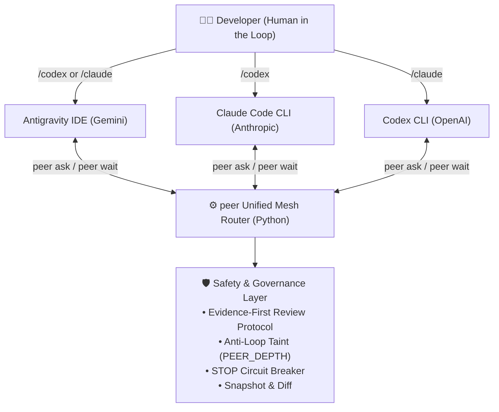

# PeerAgent 🤝

> **Get a second model to review your code — without echo chambers or extra token bills.**  
> *A lightweight, subscription-native, decentralized multi-agent mesh for developers.*

[](https://opensource.org/licenses/MIT)
[](https://www.python.org/downloads/)
[](https://github.com/puck-muling/peer-agent)

[中文文档 (README_CN.md)](./README_CN.md) | [Security Model (SECURITY.md)](./SECURITY.md) | [Architecture Guide (architecture.md)](./docs/architecture.md)

---

## 👶 10-Second Explainer: What does it do?

If you write code with **Claude Code**, **Codex CLI**, or **Google Antigravity**, you know these familiar frustrations:
* One model generates 200 lines of code, and you wonder: *"Did it introduce subtle edge-case bugs or regression errors?"*
* You want a second model to double-check it, so you manually **copy code → switch terminals → paste prompt → bring conclusions back** across multiple tedious rounds.
* Existing multi-agent frameworks require custom API keys, incurring expensive pay-per-token API bills instead of using your already-active Pro/Team subscriptions.

**With PeerAgent, you get an instant AI pairing partner right in your current terminal:**

* 🗣️ **Cross-invoke with a single slash command**: While working in Claude Code, type `/codex check my recent changes`. Codex spins up in the background and prints file:line citations directly on your screen. Conversely, type `/claude` inside Codex to have Claude review your work.
* 💰 **Subscription-Native**: Drives your locally authenticated official CLIs, consuming your existing ChatGPT Plus/Team or Claude Pro/Team subscription allowances. No extra API keys needed.
* 🛡️ **Strictly Read-Only by Default**: Code reviews run in strict read-only sandboxes. Filesystem modifications are physically prevented; editable tasks require explicit human authorization and are guarded by automated **pre/post workspace snapshot diffs**.

### Before vs. After PeerAgent

| Dimension | The Manual Way | With PeerAgent |
| :--- | :--- | :--- |
| **Cross-Model Review** | Copy code → switch window → paste prompt → copy conclusions back | **Direct from current session**: run `/codex` or `/claude`; findings return inline |
| **Billing & Cost** | API frameworks charge per token, racking up costs for long contexts | **Uses local CLI logins**: utilizes existing subscription allowances |
| **Reviewer Independence** | Placing models in the same prompt leads to sycophancy ("looks great!") | **Evidence-first protocol**: previous assumptions are kept separate; code facts checked first |
| **Safety & Blast Radius** | Risk of autonomous agents overwriting or deleting project files | **Read-only sandbox + recursion blocker + snapshot diffs** |

---

## 🚀 30-Second Quick Start

### 1. Prerequisites
* **Operating System**: macOS or Linux (Windows users should use WSL2).
* **Python**: Python 3.10+ (pure standard library; zero third-party `pip` dependencies).
* **Official CLIs (install and sign in as needed)**:
  * **Claude Code**: `npm install -g @anthropic-ai/claude-code && claude auth login`
  * **OpenAI Codex CLI**: Installed and signed in (ChatGPT Plus/Team subscription supported)
  * **Google Antigravity**: Installed (optional, for IDE-based invocations)
  > [!TIP]
  > You only need the tools you intend to use. For example, to call Codex from Claude Code, you only need `claude` and `codex` installed and authenticated.

### 2. One-Line Installation

```bash
git clone https://github.com/puck-muling/peer-agent.git
cd peer-agent
./install.sh
```

> [!NOTE]
> The installer installs the core binary into `~/.local/bin/peer` and registers slash commands under `~/.claude`, `~/.codex`, and `~/.gemini`.  
> Please ensure `~/.local/bin` is in your `PATH`.

### 3. Verification

```bash
peer doctor
```
If all checks pass, your system is ready!

### 4. Run Your First Cross-Model Review

Inside your **Claude Code** terminal, type:
```text
/codex Review recent changes in the workspace for logic flaws. Read-only review, do not modify files.
```
Codex will run in the background in a read-only sandbox. Within seconds, an independent review report citing exact file lines, impact, and recommendations will be returned directly into your conversation!

---

## 🎯 Three High-Frequency Scenarios

```
  ┌─────────────────────────────────────────────────────────────┐
  │                    Everyday Developer Flows                 │
  │                                                             │
  │   1. Pre-Commit         2. Post-Refactor      3. Design Spec│
  │   [Catch Regressions]   [Find Broken Callers] [Check Facts] │
  │        │                     │                     │        │
  │        ▼                     ▼                     ▼        │
  │   /codex on git diff    /claude on signatures /codex verify │
  └─────────────────────────────────────────────────────────────┘
```

### Scenario 1: Pre-Commit Regression Check
Inside Claude Code, call Codex as an independent gatekeeper before committing:
```text
/codex Review the current git diff, focusing on authentication checks, race conditions, and error handling. Read-only only.
```

### Scenario 2: Post-Refactor Audit
Inside Codex, after refactoring a shared module, have Claude check call sites:
```text
/claude Review the refactored auth module and verify if all callers across the repository match the updated return signature.
```

### Scenario 3: Pre-Implementation Ground-Truth Review
Inside Antigravity or terminal before executing a large architectural proposal:
```text
/codex Conduct an independent review of this proposal. First verify whether cited files and line numbers actually exist, then highlight potential risks.
```

---

## 🛡️ Trust & Safety: Four Core Guardrails

PeerAgent was built from the ground up with defensive engineering principles:

1. **Strict Read-Only Enforcement**:  
   Review tasks (`review`, `plan`, `advice`) are locked into read-only sandboxes (Codex runs with `--sandbox read-only`; Claude runs with modification tools stripped and sandboxed Bash). Modifying project files is physically prevented.
2. **Anti-Recursion Taint Tracking (`PEER_DEPTH`)**:  
   Spawned processes inherit depth environment variables. If Agent A calls Agent B, and Agent B attempts to call Agent A back, invocation is physically halted at the OS level, eliminating infinite looping.
3. **Emergency STOP Circuit Breaker**:  
   Scans error streams for account deactivation or suspension patterns. If fatal errors occur, a physical lock file (`~/.peer-review/STOP`) is written to freeze further automated calls. **AI agents are strictly forbidden from auto-recovering or deleting this lock**; human operator inspection is required. *(Note: Standard 401 token expirations prompt re-authentication and do not lock the system).*
4. **Workspace Snapshot & Diff Tracking**:  
   For explicitly authorized write tasks (`exec`), PeerAgent snapshots the workspace beforehand and generates a Unified Diff report upon completion, making all edits fully transparent.

---

## 📦 Advanced Features & Architecture

<details>
<summary><b>1. Architecture & Invocation Topology</b></summary>

PeerAgent implements a decentralized peer-to-peer (P2P) mesh without any persistent orchestrator daemon:



Every endpoint functions as both an invocation client and an expert reviewer. Read more in [Architecture Guide (docs/architecture.md)](./docs/architecture.md).
</details>

<details>
<summary><b>2. Direct Terminal CLI Usage</b></summary>

In addition to interactive slash commands, you can invoke `peer` directly from any shell or automation script:

```bash
# 1. Run diagnostic self-check
peer doctor

# 2. Launch an asynchronous read-only review
peer ask codex review --request ./task.md --cwd .

# 3. Check status of a pending run
peer status <RUN_ID> --cwd .

# 4. Wait for completion and view report & diff
peer wait <RUN_ID> --cwd .

# 5. Inspect call stats and token volume
peer stats
```
</details>

<details>
<summary><b>3. Plan Fingerprinting & Human-in-the-Loop Governance</b></summary>

For high-stakes refactoring, PeerAgent follows the **"Human as Host"** principle:
* One agent drafts an initial proposal (`plan`);
* The second agent independently verifies code premises and provides review feedback (`review`);
* The user reviews all points and selects actions;
* Running `peer freeze <plan.md> --cwd .` computes and locks the SHA-256 fingerprint, guaranteeing that subsequent execution stays strictly within the approved boundary.
</details>

<details>
<summary><b>4. Configuration Reference (~/.peer-review/config.json)</b></summary>

```json
{
  "bins": {
    "claude": "claude",
    "codex": "codex"
  },
  "models": {
    "claude": "",
    "codex": ""
  },
  "efforts": {
    "claude": "",
    "codex": "high"
  },
  "service_tiers": {
    "codex": "default"
  },
  "follow_app_settings": true,
  "approved_auth": {
    "claude": "subscription",
    "codex": "subscription"
  },
  "timeout_minutes": {
    "read": 30,
    "write": 60
  }
}
```
</details>

---

## ❓ Frequently Asked Questions (FAQ)

<details>
<summary><b>1. Does PeerAgent charge my commercial API keys?</b></summary>

By default, no. PeerAgent drives your locally installed and authenticated official CLIs (`claude`, `codex`). When signed in via interactive subscriptions (e.g. ChatGPT Plus/Team or Claude Pro/Team), it utilizes those existing subscription allowances. Usage terms and rate limits are governed by the respective providers.
</details>

<details>
<summary><b>2. What should I do if a "Circuit breaker STOP lock active" error appears?</b></summary>

If critical account suspension patterns are detected, PeerAgent writes a `STOP` or `STOP-<agent>` file in `~/.peer-review/`.  
**Resolution Steps**:
1. Check the exact lock file path reported in the output;
2. Verify why it occurred and confirm the health and auth status of the underlying CLI;
3. Once verified, manually delete the specific lock file (e.g. `rm ~/.peer-review/STOP-codex`). Avoid using wildcard deletion.
</details>

<details>
<summary><b>3. Why is native Windows unsupported?</b></summary>

PeerAgent relies on POSIX file locking (`fcntl.flock`) and process group signal management (`os.killpg`) to guarantee safe cross-process concurrency and cleanup. Windows users should run inside **WSL2** (Windows Subsystem for Linux).
</details>

---

## ⚖️ Objective Comparison

| Dimension | Manual Transfer | Commercial API Frameworks (LangGraph, CrewAI) | PeerAgent |
| :--- | :--- | :--- | :--- |
| **Workflow** | Manually copy text, switch windows, paste prompt, bring findings back | Requires custom orchestration scripts or server daemons | **One slash command in current terminal; results return in place** |
| **Billing Model** | Native subscriptions (manual effort) | Pay-per-token commercial API keys required | **Drives local official CLIs; uses existing subscriptions** |
| **Dependencies** | None | Multiple heavy Python or Node packages | **Pure Python 3.10+ standard library; zero external dependencies** |
| **Review Isolation** | Relies entirely on manual filtering | Requires custom isolation pipelines | **Evidence-first protocol; ground-truth code verified before proposals** |
| **Recursion Prevention**| Manual intervention | Turn-counter limits only | **OS-level `PEER_DEPTH` environment taint; physical cutoff** |
| **Safety Circuit Breaker** | None | Typically relies on unhandled exceptions | **Physical `STOP` lock files; blocks AI auto-recovery** |

---

## 📄 License & Security

Released under the [MIT License](./LICENSE).  
For detailed information on sandbox boundaries, authentication policies, and vulnerability reporting, please review the [Security Policy (SECURITY.md)](./SECURITY.md).
