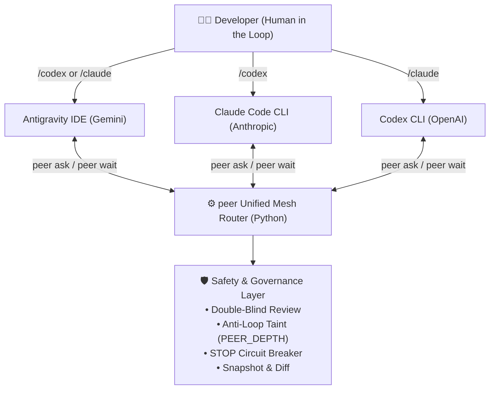

# PeerAgent 🤝

> **Make Claude Code and Codex review each other — without fake consensus.**  
> *A lightweight, subscription-native, decentralized multi-agent mesh for developers.*

[](https://opensource.org/licenses/MIT)
[](https://www.python.org/downloads/)
[]()

[中文文档 (README_CN.md)](./README_CN.md) | [Security Model](./SECURITY.md) | [Architecture Guide](./docs/architecture.md)

---

## 💡 Why PeerAgent?

Current multi-agent frameworks (CrewAI, AutoGen, LangGraph) share three glaring pain points:
1. **Expensive API Bills**: They require direct API keys, burning hundreds of dollars in raw token costs instead of leveraging your existing subscriptions (ChatGPT Plus/Team, Claude Pro/Team).
2. **Disconnected from Reality**: They run in abstract Python loops, isolated from your real IDE context, native terminal sandboxes, and official developer tools.
3. **The "Echo Chamber" (Fake Consensus)**: When Agent A proposes a flawed design, Agent B typically flatters it, creating an illusion of agreement without actually verifying ground-truth code.

**PeerAgent flips the script.** It acts as a lightweight, decentralized Unix glue between your favorite developer tools: **Google Antigravity (Gemini)**, **Anthropic Claude Code**, and **OpenAI Codex CLI**.



---

## ⚡ Key Highlights

* **💰 Zero Extra API Billing (Subscription-Native)**: Directly drives official, locally logged-in CLIs (`claude -p`, `codex exec`). Uses your existing Pro/Team memberships without paying double for API credits.
* **🌐 Decentralized Mesh (P2P)**: No central master daemon. Call `/codex` from inside Claude Code, `/claude` from inside Codex, or call either from Antigravity. Any agent can act as both caller and expert reviewer.
* **🔍 Double-Blind Review Protocol**: Reviewers are forbidden from accessing previous intermediate outputs. The task specification forces ground-truth evidence (file:line, git diff) to the top: reviewers must verify code premises before examining proposals.
* **🔄 Anti-Recursion Taint Tracking (`PEER_DEPTH`)**: Propagates process depth markers. If Agent A calls Agent B, Agent B is physically blocked from recursively calling Agent A back, eliminating token-draining infinite loops.
* **🛑 Emergency STOP Circuit Breaker**: Scans for fatal account warnings, ban patterns, or 401 token revocations. Immediately writes a physical `STOP` lock and halts execution. **Agents are strictly forbidden from auto-recovering locks**; only humans can review and release.
* **📸 Snapshot & Diff Tracking**: Read-only modes (`review`, `plan`, `advice`) are locked in strict sandboxes. Write modes (`exec`, `image`) require explicit human quotes and automatically snapshot the workspace, generating detailed `changes.diff` upon completion.

---

## 🚀 Quick Start

### Prerequisites
* macOS or Linux (WSL on Windows supported; native Windows unsupported due to POSIX `fcntl` file locks)
* Python 3.10+
* At least one of the official CLIs installed and authenticated:
  * [Claude Code](https://docs.anthropic.com/en/docs/claude-code): `npm install -g @anthropic-ai/claude-code && claude login`
  * [OpenAI Codex CLI](https://platform.openai.com/docs): Installed and authenticated via ChatGPT subscription.
  * [Google Antigravity](https://deepmind.google/): Installed and configured.

### One-Line Installation

```bash
git clone https://github.com/shixiaofei-sunny/peer-agent.git
cd peer-agent
./install.sh
```

To install in developer mode (using symlinks so your edits take effect immediately):
```bash
./install.sh --link
```

Verify your installation:
```bash
peer doctor
```

---

## 📖 How to Use

### 1. In Google Antigravity
Type in your chat prompt:
```text
/codex Review the authentication logic in src/auth.py and check for race conditions
/claude Help design a clean cache invalidation strategy for redis_cache.py
/codex image Draw an architectural poster of our multi-agent workflow
```

### 2. In Claude Code CLI
Inside your Claude Code terminal, simply trigger the slash command:
```text
/codex Check if my recent changes in git diff introduce any regression bugs
/codex advice Why is the database connection pool timing out under high concurrency?
```

### 3. In OpenAI Codex CLI
Inside your Codex conversation:
```text
/claude Review the refactored React component and check for unnecessary re-renders
```

---

## 🛡️ Governance Workflow (Human in the Loop)

PeerAgent follows the **"Human as the Host"** doctrine. AI agents propose, inspect, and verify; **humans decide**.

```text
1. Propose Plan   ──> /codex plan <feature>
2. Cross-Review   ──> /claude review <proposal> (Independently verifies ground-truth)
3. Synthesize     ──> Combine all findings into itemized points (S01, S02...)
4. Boss-Review ①  ──> Human selectively approves / rejects / modifies each point
5. Freeze Hash    ──> peer freeze <plan.md> (Calculates SHA-256 fingerprint)
6. Execute        ──> peer verify & peer ask <agent> exec (Strictly within frozen scope)
```

---

## ⚙️ Configuration & Direct CLI

PeerAgent stores user settings in `~/.peer-review/config.json`. A default template is generated on install:

```json
{
  "bins": {
    "claude": "claude",
    "codex": "codex"
  },
  "models": {
    "claude": "",
    "codex": ""
  },
  "efforts": {
    "claude": "",
    "codex": "high"
  },
  "service_tiers": {
    "codex": "default"
  },
  "follow_app_settings": true,
  "approved_auth": {
    "claude": "subscription",
    "codex": "subscription"
  },
  "timeout_minutes": {
    "read": 30,
    "write": 60
  }
}
```

You can also use the `peer` CLI directly from your terminal:
```bash
# System diagnostic & auth check
peer doctor

# Launch an asynchronous read-only review
peer ask codex review --request ./task.md --cwd .

# Wait for completion & view diff
peer wait <RUN_ID> --cwd .

# View daily call statistics and token volume
peer stats
```

---

## ❓ Frequently Asked Questions (FAQ)

<details>
<summary><b>1. Does PeerAgent charge my OpenAI / Anthropic API keys?</b></summary>
No. PeerAgent executes the official local CLIs (`codex`, `claude`) using your existing interactive subscription logins (ChatGPT Plus/Team, Claude Pro/Team). If you prefer using pay-as-you-go API keys, you can configure them, but subscriptions are supported out of the box.
</details>

<details>
<summary><b>2. What happens if an agent triggers a rate limit or account issue?</b></summary>
If fatal account issues (such as suspension warnings) are detected, PeerAgent halts immediately and drops a physical `STOP` lock file in `~/.peer-review/STOP`. AI agents are strictly blocked from deleting this lock file; only a human operator can verify the account and remove the lock.
</details>

<details>
<summary><b>3. Why is native Windows unsupported?</b></summary>
PeerAgent relies on POSIX-compliant process group signaling (`os.killpg`) and Unix advisory file locking (`fcntl.flock`) for cross-process concurrency safety. Windows users are strongly encouraged to run inside **WSL2** (Windows Subsystem for Linux).
</details>

---

## ⚖️ Architecture Comparison

| Feature | PeerAgent | LangGraph / CrewAI | Single-Model CLI | Local MCP Bridges |
| :--- | :---: | :---: | :---: | :---: |
| **Billing Model** | **Subscription-Native ($0 extra)** | Pay-per-token API | Subscription | Subscription |
| **Multi-Model Cross-Check** | **Yes (P2P Mesh)** | Central Orchestrator | No (Single model) | Fragile sockets |
| **Anti-Fake Consensus Protocol** | **Yes (Double-Blind)** | No | N/A | No |
| **Infinite Loop Prevention** | **Yes (`PEER_DEPTH` Taint)** | Turn limit | N/A | No |
| **Safety Circuit Breaker** | **Yes (STOP Lock)** | No | No | No |
| **Workspace Snapshot & Diff** | **Yes (Automatic)** | No | Native git | No |
| **Zero Heavy Dependencies** | **Yes (Python Standard Lib)** | Heavy packages | Standalone | Node/Docker |

---

## 📄 License

PeerAgent is released under the [MIT License](./LICENSE).
