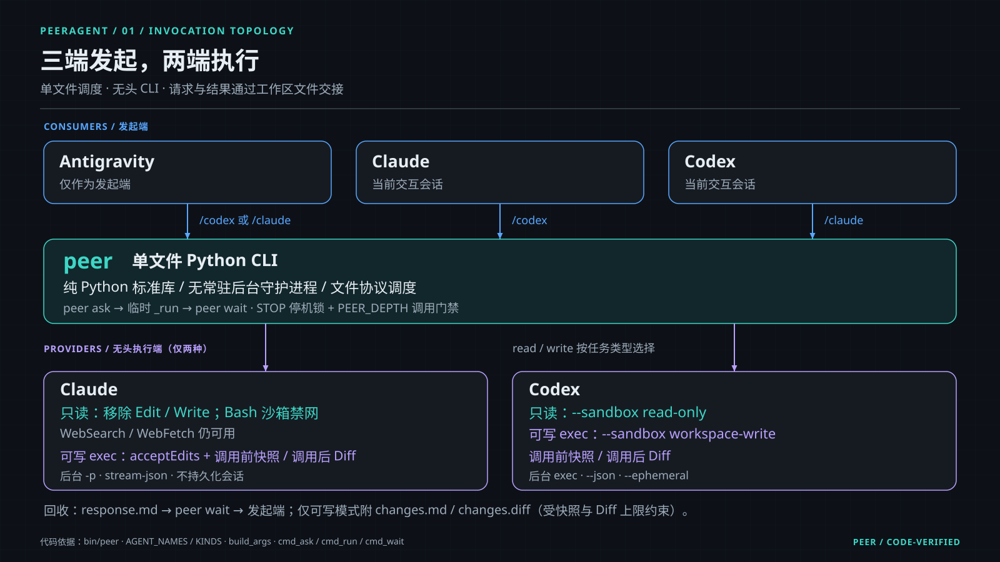
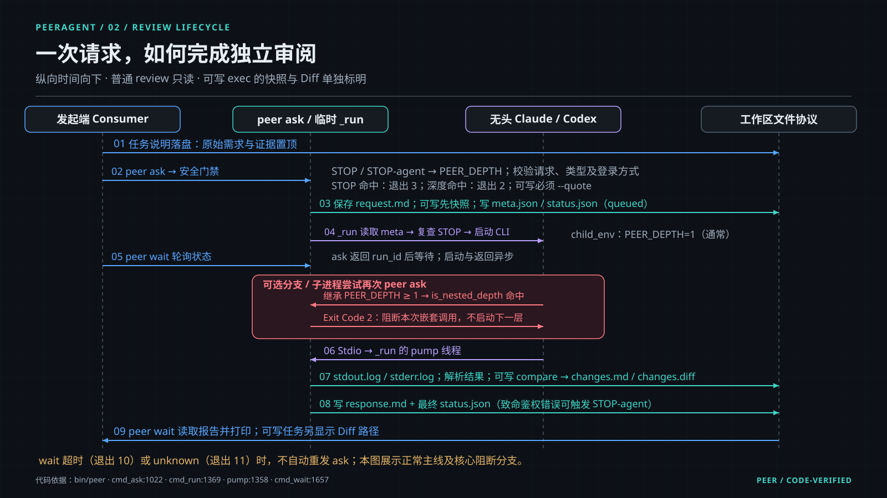
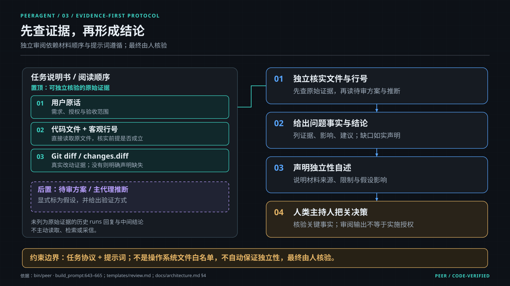
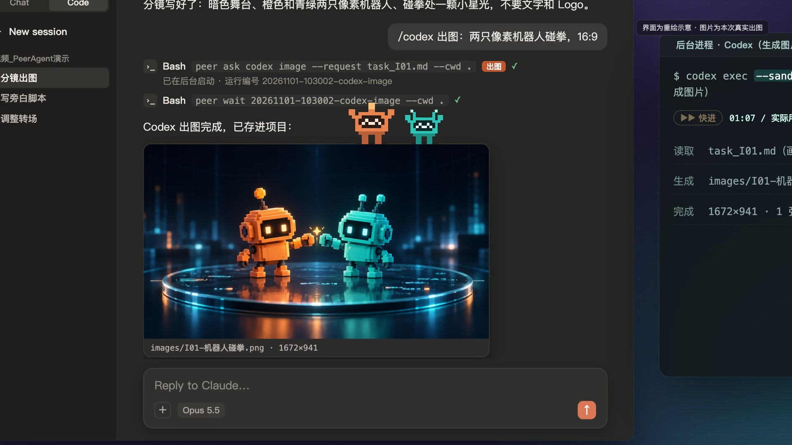
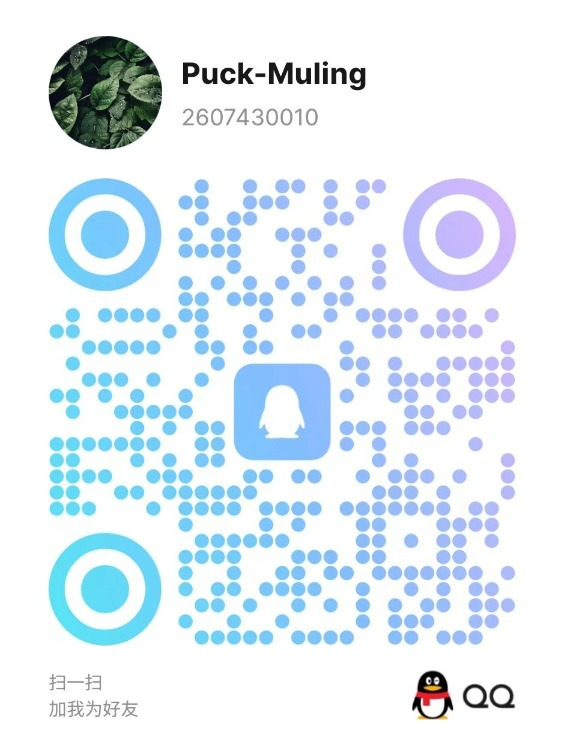

<div align="center">

[简体中文](README_CN.md) | **English**

# PeerAgent 🤝

**Let Claude Code and Codex review each other's code. Less copy-pasting, another independent opinion.**

Ask another model to check your code from your current session and bring the findings back, without switching windows.

Local official CLIs · Existing subscriptions supported · Read-only reviews · Silent billing lock · Fatal ban circuit breaker · Python stdlib only

[Install and try it](#install-and-try-it) · [Ecosystem positioning & comparison](#ecosystem-positioning--comparison) · [Usage examples](#usage-examples) · [Costs and permission boundaries](#costs-and-permission-boundaries) · [Troubleshooting and network FAQ](#troubleshooting-and-network-faq)

[](https://github.com/puck-muling/peer-agent/actions/workflows/ci.yml)
[](./LICENSE)
[](https://www.python.org/downloads/)

</div>

## Demo video

https://github.com/user-attachments/assets/6e51e140-c110-4447-9d02-287796e750cd

▶ [Direct link / Download MP4](https://cdn.jsdelivr.net/gh/puck-muling/peer-agent@main/docs/assets/demo.mp4) (2 min 21 s, Chinese narration and subtitles)

> [!NOTE]
> **Notice on Same-Named Projects**: This project (`puck-muling/peer-agent`) is a lightweight **multi-agent safety governance & peer-review middleware** for real-world software engineering (running via local official CLIs, zero third-party pip dependencies, hardened billing gates and circuit breakers). It is completely distinct in architecture and use-case from `hirak99/peer-agent` (an HTTP/FastAPI-based companion agent framework).

For developers already using Claude Code or Codex who want a second review. You need **Python 3.9+ and the official CLI for the model you want to call**. Subscription runs still consume quota; actual billing depends on the login mode and tools used. Installation targets macOS and Linux; on Windows, install and run PeerAgent inside WSL2 (native Windows only gets graceful degradation for file locks and process termination, and `install.sh` does not support it).

## Ecosystem positioning & comparison: Not just a bridge, but a safety governance layer

With the evolution of the official Claude Code and Codex ecosystems, developers often ask: *"Now that there are official plugins (such as `openai/codex-plugin-cc`) and MCP tools (like `consult`), is PeerAgent obsolete?"*

**The answer is no: forwarding requests is trivial, but real-world multi-agent collaboration fails without safety and cost governance.**

Basic forwarding bridges (Plugins or MCP tools) simply pass prompts across models, leaving critical engineering risks unaddressed:
1. **Silent billing switches**: Lingering API keys in environment variables or expired sessions silently fall back to metered API billing, resulting in hundreds of dollars in unexpected charges.
2. **Cascade account bans**: When encountering IP or geographic risk triggers, automated scripts enter retry loops, triggering account-wide suspensions.
3. **Echo chambers & sycophancy**: Later models reflexively agree with the previous model's assumptions rather than independently verifying code facts.
4. **Context amnesia & plan creep**: Over long conversations, models drift from agreed architectural decisions and introduce scope creep.

PeerAgent's moat lies in **encapsulating model interactions within a hardened defense system**:

| Dimension | PeerAgent (This project) | Official Plugin (openai/codex-plugin-cc) | MCP Tool (neelsatyavolu/consult, etc.) | Companion Server (hirak99/peer-agent) |
| :--- | :--- | :--- | :--- | :--- |
| **Core Role** | **Multi-Agent Safety Governance & Peer Review** | One-way dispatch plugin | MCP-based model consulting | HTTP/FastAPI companion server |
| **Topology** | **Claude ↔ Codex ↔ Antigravity bidirectional loop** | Codex → Claude one-way | Host → multi-model star hub | Client ↔ companion service API |
| **Silent Billing Lock (`approved_auth`)** | ✅ **Pre-flight verification, blocks surprise API charges** | ❌ No check, vulnerable to env leakage | ❌ Relies on client configuration | ❌ Relies on custom auth setup |
| **Account Ban Circuit Breaker (`STOP`)** | ✅ **Process-group signal handling + STOP circuit breaker: scans for fatal ban signatures after the child exits and writes a STOP lock that blocks further runs** | ❌ Process exits with error; no locking | ❌ No circuit breaker protection | ❌ None |
| **Pre-Write Snapshots & Unified Diff** | ✅ **Automatic pre-write snapshot + post-run Unified Diff** | ❌ No pre-write snapshot; manual git diff | ❌ Up to host client implementation | ❌ None |
| **Architecture Decision Freeze (`peer freeze`)** | ✅ **SHA-256 fingerprint + standalone handover prompt** | ❌ None | ❌ None | ❌ None |
| **Adversarial / Anti-Sycophancy Protocol** | ✅ **Tool allow-list limits + prompt rules: read-only tool list, instructions not to rely on prior replies, evidence first (not OS-level isolation)** | ❌ Carries prior history; prone to bias | ❌ Dependent on prompt authoring | ❌ No standardized protocol |
| **Runtime & Dependencies** | **Single-file CLI using Python standard library, 0 pip dependencies** | Tied to Codex plugin runtime | Requires Node.js / MCP runtime | Requires FastAPI / pip packages |

## Install and try it

### Choose your calling path

| Calling path | What you need |
| :--- | :--- |
| `/codex` from Claude Code | A working Claude Code session and a locally installed, signed-in Codex CLI |
| The `/claude` skill from Codex | A working Codex session and a locally installed, signed-in Claude Code CLI |
| Either model from Antigravity | The Antigravity host and the signed-in official CLI for the target model |
| Direct `peer ask` | Python 3.9+ and the signed-in official CLI for the target model |

PeerAgent does not install these CLIs or log in for you. Prepare the target CLI and confirm it works on its own before installing PeerAgent. A one-way workflow does not require activating an unused calling channel.

### 30-second quickstart commands

With prerequisites ready, this is the installation entry point. Downloads and the first run depend on your network and task size:

```bash
git clone https://github.com/puck-muling/peer-agent.git
cd peer-agent
./install.sh
peer doctor
```

The installer defaults to **file copies**. It copies `peer` to `~/.local/bin/peer` and `$PEER_HOME/bin/peer` (`PEER_HOME` defaults to `~/.peer-review`), copies templates and host skills, creates a default config if absent, and adds PATH configuration where supported by the shell. Developers can explicitly select symlinks with `./install.sh --link`. With copy installation, repository edits do not update installed copies automatically.

> [!IMPORTANT]
> `pip install` only installs the `peer` command itself and **does not register the host agent skills** (`/codex`, `/claude`). Run `./install.sh` from the repository afterwards to install the skills for Claude, Codex (`~/.codex/skills` and `~/.agents/skills`) and Antigravity.

If the current terminal cannot find `peer` yet, use the installed path:

```bash
"$HOME/.local/bin/peer" doctor
```

`peer doctor` is the core diagnostic and safety-lock inspection tool, reporting CLI status, login-category consistency with `approved_auth`, and STOP circuit breaker state. **Do not use `peer doctor --approve` as a generic repair command**: it is the authorization tool for the silent billing prevention lock (`approved_auth`), writing currently recognized login categories into the approved config; check its output and billing mode first, and run it only after human verification.

### Run your first review

Reopen or refresh the host client after installation and confirm the skill has loaded. In the project you want reviewed, enter this in **Claude Code**:

```text
/codex review the current git diff, focusing on error boundaries. Do not modify files.
```

In **Codex**, invoke the `/claude` skill (the exact entry point depends on the client's skill menu):

```text
/claude review the current git diff for regressions. Do not modify files.
```

This only illustrates a possible result format. **It is not an original report from a historical run**; the location is illustrative, and findings and latency depend on the task:

```markdown
## Review findings (illustration)

- Location: src/handler.py:42 (illustrative)
- Issue: The failure branch does not close a resource, which may exhaust connections after repeated requests.
- To verify: Check whether the caller owns cleanup and run tests covering the failure branch.
```

Check the reported location and trigger before deciding to edit. A second model can miss issues or make incorrect judgments too.

## Usage examples

| Goal | Example |
| :--- | :--- |
| Ask Codex to check changes | `/codex review the current git diff for races and error boundaries. Do not modify files.` |
| Ask Claude for a refactoring plan | `peer ask claude plan --request ./plan-task.md --cwd .` (prepare the task file first) |
| Authorize a specific fix | `/codex exec Authorized: fix the confirmed resource cleanup issue, changing only that function.` |
| Generate an image (Codex only) | `/codex image Authorized: draw a call flow diagram in the specified project asset directory.` |
| Save a plan version and fingerprint | `peer freeze ./plan-v2.md --cwd .` |
| Inspect environment and safety locks | `peer doctor` |
| Approve / update login billing mode | `peer doctor --approve` (run by user after verification to prevent silent billing) |
| Emergency killswitch for automated calls | `touch ~/.peer-review/STOP` (must be manually deleted to reset; AI cannot clear it) |

### Review, planning, and execution

Slash skills use keyword-based intent routing. It is a heuristic, not a complete understanding of natural language. The following order applies to **the `/codex` skill in Claude Code**:

1. An explicit leading `exec` / `review` / `plan` / `advice` / `image` selects that type; `exec` is downgraded to `review` when a read-only or no-edit requirement is detected.
2. Without an explicit type, recognized negative phrases and review verbs take precedence over edit verbs. For example, reviewing changes or checking a fix stays a review.
3. The remaining checks match plan, image, edit, and advice phrases in that order, with `review` as the fallback. Phrase coverage varies by language; use an explicit type when possible.

The `/claude` skill in Codex and the Antigravity skills use different classification rules; do not assume identical precedence across hosts. Check the corresponding skill and actual call type. To select a type deterministically, use direct `peer ask`, which bypasses slash-skill intent routing.

`review`, `plan`, and `advice` use read-only execution settings. `exec` and `image` can write and require a user authorization quote. Specify allowed files clearly and check the submitted task type.

### Call directly from a terminal

Create `review-task.md` in the project with the files, original requirements, and response format. For example:

```markdown
# Task

Review the current git diff, focusing on error handling. Do not modify files.

## Response format

List locations, triggers, evidence, and remaining checks. Say explicitly if no issues were found.
```

Then invoke the target CLI:

```bash
peer ask codex review --request ./review-task.md --cwd .
```

This starts a background run and returns a run ID. Replace `RUN_ID` below with that ID:

```bash
peer wait RUN_ID --cwd .
peer status RUN_ID --cwd .
peer stats
```

A `peer wait` timeout means the result has not arrived during that wait. Inspect or wait for the original run; do not submit another `ask`.

For a write task, prepare a separate task file and pass the user's actual approval:

```bash
peer ask codex exec --request ./fix-task.md --cwd . \
  --quote 'Fix only the confirmed resource cleanup issue'
```

The program only checks that `--quote` is nonempty. It does not establish whether the quote authorizes every action. Pre-run snapshots live in `.peer-review/runs/<run_id>/snapshot/`; completion generates `changes.md` and `changes.diff`. Snapshot limits are described below.

### Host two reviews in Antigravity

Ask Claude and Codex to inspect the same source and requirements separately, then have the host summarize locations, evidence, and disagreements. Task instructions ask reviewers to check original evidence before accepting existing conclusions. **This is not OS-level blind-review isolation.** Request text is passed directly to the called model, so the host should keep the other reviewer's conclusions out of an independent review request.

After a person confirms the plan, save a frozen copy:

```bash
peer freeze ./plan-v2.md --cwd .
peer verify ./plan-v2_冻结v001.md
peer since-freeze ./plan-v2_冻结v001.md
```

This assumes the first freeze of that document; use the filename printed by the command. `freeze` creates `*_冻结vNNN.md`, a content fingerprint, project snapshot, and handoff text. It runs in standalone mode by default. Optional `--review-receipt <dir>` validates an external final-review receipt; without one, freezing does not establish approval. SHA-256 detects content changes; it does not prevent edits or authorize implementation.

<details>
<summary>Complete command index</summary>

| Command | Arguments and behavior |
| :--- | :--- |
| `peer doctor` | `[--approve]`: inspect environment and safety locks (CLI status, login consistency, and STOP circuit breaker); explicitly approving records currently recognized login categories as the new baseline |
| `peer ask <codex\|claude> <kind>` | `--request <file> --cwd <dir>`; `kind`: `review` / `plan` / `advice` / `exec` / `image`; `image` is Codex-only |
| Optional call arguments | `--quote <text>`, `--model <model>`, `--effort <effort>`, `--service-tier <tier>`, `--add-dir <dir>`, `--caller <name>`, `--foreground`; write types require `--quote` |
| `peer wait <run_id>` | `--cwd <dir> [--timeout <seconds>]`: wait for the original run and show the report |
| `peer status [run_id]` | `--cwd <dir>`: inspect a run or the latest 10 runs |
| `peer freeze <plan>` | `--cwd <dir> [--quote <text>] [--review-receipt <dir>]`: save a frozen copy and fingerprint |
| `peer verify <frozen>` | Compare the frozen copy with its recorded SHA-256 |
| `peer since-freeze <frozen>` | Compare the project with its freeze snapshot and generate change records |
| `peer stats` | Show daily calls and available usage data, not an official billing statement |

</details>

## Costs and permission boundaries

| Mechanism | What it does | Limits |
| :--- | :--- | :--- |
| Login-category check (`approved_auth`) | Compares the current category with `approved_auth`; mismatch stops the call with exit code 3; managed via `peer doctor [--approve]` | Does not verify authorization scope, remaining credit, or final charges. Subscription calls consume quota; API logins follow their billing rules |
| Read-only tasks | Sets Codex's `read-only` sandbox; restricts Claude tools and Bash sandbox permissions; requests read-only behavior in the prompt | Depends on the target CLI and system sandbox. PeerAgent still writes task files and logs; the machine is not entirely write-free |
| Write authorization | Requires a nonempty quote for `exec` / `image` and uses write settings | A quote does not mean the program understands its scope; people and the executor must check it |
| Pre-run snapshot | Copies eligible text content, records file information, and compares afterward | Skips some directories and suspected secrets; size, binary, and total-copy limits apply. Not a full backup or automatic rollback |
| Recursion marker | Inherited `PEER_DEPTH` causes nested `peer ask` calls to exit with code 2 | Covers this entry point with its marker intact, not every possible agent loop |
| STOP circuit breaker (`STOP`) | Blocks later calls on a channel after detecting fatal ban or region errors; managed via `peer doctor` and manual killswitch / reset | Depends on error matching and cannot guarantee account protection. Investigate manually; AI agents are strictly forbidden from removing STOP files |
| Independent-review instructions | Ask reviewers to inspect source, requirements, and diffs before judging claims | Do not guarantee correctness, independence, or consensus |

Snapshots skip directories such as `.git`, `node_modules`, and `.peer-review`. Text files over 2 MiB are not copied; files over 64 MiB only have size and modification time recorded. Total copied content is capped at 300 MiB and file count at 40,000. See [`bin/peer`](./bin/peer) for details and [SECURITY.md](./SECURITY.md) for the security model.

### Core safety locks and tools: silent billing prevention & fatal ban circuit breaker

When running multi-agent workflows autonomously, developers face two major risks: **"silently falling back from a flat subscription to pay-per-token API keys, resulting in surprise bills"** and **"automated loops repeatedly hitting fatal authentication errors or platform bans, triggering cascading account suspensions"**. PeerAgent enforces two pre-flight guardrails with dedicated inspection tools:

#### 1. `approved_auth` Authentication Mode Lock (Silent Billing Prevention)

* **Interception mechanism**: Before sending any prompt (`peer ask`), PeerAgent queries the target CLI's actual login state and inspects active environment variables. It verifies that the current mode (`subscription` / `api` / `unknown`) matches `approved_auth` in your configuration (defaulting to `subscription`).
* **Why it prevents silent charges**: If you use Claude Pro or ChatGPT Plus subscriptions but an environment variable (e.g. `ANTHROPIC_API_KEY` or `OPENAI_API_KEY`) is accidentally injected, or if a subscription session expires into pay-as-you-go API credits, PeerAgent detects that the current login state no longer matches the approved mode (`approved_auth`) and **blocks the call and exits with code 3 before invoking the CLI**, printing the mismatch and refusing to execute. It only compares login categories; it does not verify authorization scope, remaining credit, or final charges.
* **Management tools**:
  * **Diagnostic tool `peer doctor`**: Inspects each CLI's detected login mode against `approved_auth` (displaying `✅ matches approved baseline` or `⚠️ mismatch`).
  * **Approval tool `peer doctor --approve`**: When you intentionally switch to official API keys and accept the billing implications, explicitly run this command to record the new baseline. AI agents are strictly forbidden from invoking `--approve` automatically.

#### 2. `STOP` Fatal Ban Circuit Breaker & Emergency Killswitch

* **Interception mechanism**: After the child CLI exits and its output has been collected, PeerAgent scans the error stream for fatal account ban signatures (including `account deactivated/suspended/banned`, `organization_disabled`, and `unsupported_country`). On a match, it immediately writes a STOP lock file into `$PEER_HOME` (`STOP-codex`, `STOP-claude`, or global `STOP`) recording the timestamp, reason, and run ID.
* **Why it prevents cascading account bans**: In autonomous or batch runs, repeated attempts against an already flagged or blocked account often trigger permanent platform bans across all associated credentials. The STOP lock blocks all future runs at the pre-flight gate. Routine 401 token expirations or transient network timeouts do not trigger the STOP lock.
* **Emergency killswitch & manual reset protocol (safety redline)**:
  * **Manual killswitch**: Users can pull the emergency brake at any time by running `touch ~/.peer-review/STOP`.
  * **AI reset strictly forbidden**: While a STOP lock is active, `peer` rejects all calls with exit code 3. **AI agents are strictly prohibited from deleting STOP files**. A human user must investigate the root cause, verify account security, and manually remove the lock file in a terminal (e.g., `rm ~/.peer-review/STOP*`) to restore service.
  * **Diagnostic tool `peer doctor`**: When a circuit breaker is triggered, `peer doctor` highlights the exact lock path, trigger reason, and timestamp in red alerts, exiting with code 3 to stop automated harnesses.

## Troubleshooting and network FAQ

### `peer` or a target CLI cannot be found

Reopen the terminal to load PATH changes or use the fixed `~/.local/bin/peer` path above. If a target command is missing, confirm its CLI is installed and visible in the environment that starts the host. Set `bins.claude` / `bins.codex` to its actual absolute executable path if needed. Restart the host after changing PATH or configuration.

### Not signed in, or login category mismatch

Check the original channel's official CLI login status. If needed, log in using that CLI's flow, then run `peer doctor`. If you intentionally changed login mode, confirm subscription/API billing expectations before personally deciding to run `peer doctor --approve`. It records recognized categories; it does not repair networking, quota, or account permissions.

### `/codex` or `/claude` is missing after installation

Refresh or reopen the host and check that the skill is in the configuration directory that client actually uses. The installer copies skills to the default Claude, Codex, and Antigravity directories; custom config directories need to be checked against client settings. Menu behavior depends on client version. Direct `peer ask` can help isolate the calling path.

### In mainland China or another restricted network, the proxy port connects but requests fail

`proxy_check` **only attempts a TCP connection to the configured host and port**. It does not configure a proxy or validate HTTP/SOCKS behavior, authentication, DNS, TLS, or model-service reachability. Set your actual local port if you want this check:

```json
{
  "proxy_check": ["127.0.0.1", 7890]
}
```

This only makes `peer doctor` probe the port. Configure proxy addresses, protocols, and environment variables separately in the environment running the official CLI. Child processes inherit that environment, but support depends on the target CLI. Check the official CLI's network state in the same terminal, then verify the host inherits the same environment. A desktop-launched client may not inherit terminal proxy variables.

Package downloads and model-service requests are separate paths. Successful installation does not prove model-service access. For proxy timeouts, check the port, protocol, and target service first. No unverified mirrors or service-restriction workarounds are provided here.

### A task timed out or has `unknown` status

Use the original run ID with `peer status`, then inspect that run's status, report, and error files. A wait timeout can be followed by another `peer wait`. `unknown` means the process ended without a collected result, not that the request was never submitted. Do not resubmit or switch accounts while the outcome is unclear. Check the original task and account; only send a new request after confirming non-acceptance and obtaining retry authorization. PeerAgent does not retry automatically.

### A model or effort setting is unsupported

Models are blank by default and follow client settings; the config fixes Codex effort to `high` by default. Confirm target CLI support before specifying a model or effort. Precedence: call arguments > fixed config > client settings > CLI defaults. A parameter accepted by PeerAgent is not necessarily supported by the target service.

## Configuration reference

Default config: `~/.peer-review/config.json`. Use `PEER_CONFIG` for another path. These defaults match [`config.example.json`](./config.example.json):

```json
{
  "bins": {
    "claude": "claude",
    "codex": "codex"
  },
  "models": {
    "claude": "",
    "codex": ""
  },
  "efforts": {
    "claude": "",
    "codex": "high"
  },
  "service_tiers": {
    "codex": "default"
  },
  "follow_app_settings": true,
  "approved_auth": {
    "claude": "subscription",
    "codex": "subscription"
  },
  "max_turns": {
    "read": 20,
    "write": 120
  },
  "timeout_minutes": {
    "read": 30,
    "write": 60
  },
  "proxy_check": null,
  "codex_disable_apps": false
}
```

| Setting | Meaning |
| :--- | :--- |
| `bins` | Target CLI command name or absolute executable path |
| `models` | Fixed model; empty means try to follow client settings rather than hard-coding a model name |
| `efforts` | Fixed reasoning effort; empty means try to follow the client. Supported values depend on the target CLI |
| `service_tiers.codex` | This coordinator currently accepts only `default` or `flex`; default is `default` |
| `follow_app_settings` | Read client settings when the corresponding fixed value is empty |
| `approved_auth` | Approved login categories, both `subscription` by default; mismatches block calls |
| `max_turns` | Currently passed to the Claude CLI, not a universal loop limit for both agents |
| `timeout_minutes` | Maximum read/write task duration in minutes before terminating the child; does not establish that a remote request was not processed |
| `proxy_check` | Optional `[host, port]` TCP check; does not configure a proxy |
| `codex_disable_apps` | Pass a setting to disable Codex Apps; default `false`, separately disabled for image tasks |

To fix effort at high while retaining model inheritance, merge this fragment:

```json
{
  "efforts": {"claude": "high", "codex": "high"}
}
```

If intentionally switching to an official API login, complete and confirm it in that CLI, inspect `peer doctor`, and then decide whether to approve the new category. Do not approve merely to dismiss an error.

### Environment variables

| Variable | Default and purpose |
| :--- | :--- |
| `PEER_HOME` | `~/.peer-review`; configuration, templates, and global call logs |
| `PEER_CONFIG` | `$PEER_HOME/config.json`; explicit config path |
| `PEER_TEMPLATES_DIR` | Override templates; otherwise prefer `templates/` beside the program's repository, then `$PEER_HOME/templates` |
| `PEER_DEPTH` | Defaults to 0; the coordinator marks child depth to reject nested calls |
| `HTTP_PROXY` / `HTTPS_PROXY` / `ALL_PROXY` | Inherited from the launch environment; target CLI support determines behavior. PeerAgent does not set them automatically |

## What's inside and how it works

| Component | Path and description |
| :--- | :--- |
| Core coordinator | [`bin/peer`](./bin/peer), currently 2,028 lines, Python standard library only, no persistent daemon |
| CLI adaptation skills | [`skills/`](./skills/), for Claude Code, Codex, and Antigravity; not official vendor products |
| Task templates | [`templates/`](./templates/), 5 files: `review.md`, `plan.md`, `advice.md`, `exec.md`, `image.md` |
| Installer | [`install.sh`](./install.sh), file copies by default; symlinks are opt-in |
| Tests | [`tests/`](./tests/), test cases for core behavior |
| Architecture | [`docs/architecture.md`](./docs/architecture.md), design details and diagrams |

Flow: save the task → check login category, STOP files, and call depth → launch the local CLI → collect results and return a report. Claude Code, Codex, and Antigravity can initiate calls; local Claude / Codex CLIs execute them.

<details>
<summary>Architecture diagrams and existing demo assets</summary>







This existing demo cover contains robot image generation and a redrawn interface; **it is not a recording of code review**. Historical promotional wording in the image is not a capability guarantee. Refer to this page and the source for current behavior and limits.



</details>

## Why we built it

After writing code, we often want another model to check it. Copying code, switching windows, and moving feedback back is tedious. PeerAgent connects that step to the existing session using local signed-in CLIs.

More importantly, **it is forged from hundreds of high-intensity multi-agent production workflows**:
- Successfully powered **372+ code & plan cross-reviews**, **235+ architectural consultations**, and **283+ cross-model image generations**;
- Maintained a record of **zero accidental billings** and **zero account bans** throughout high-frequency runs;
- `approved_auth` has caught and blocked accidental transitions to metered API keys 4 separate times;
- The `STOP` circuit breaker has repeatedly halted concurrent retry cascades during proxy disruptions, protecting precious subscription accounts.

If you want a dependable, safe, and cost-controlled second pair of eyes across your existing AI coding CLIs, PeerAgent is built for you.

## Community

Bug reports, suggestions, and usage discussions are all welcome:

- 🐛 **Issues**: [GitHub Issues](https://github.com/puck-muling/peer-agent/issues)
- 𝕏 **X (Twitter)**: [@puck_muling](https://x.com/puck_muling)

### 💬 QQ

Add author on QQ: **2607430010** (Puck-Muling) for questions and technical discussion:

<p align="center">
  
</p>

### ✈️ Telegram

Join our Telegram community to discuss multi-agent workflows in practice: [@puckmuling](https://t.me/puckmuling):

<p align="center">
  
</p>

---

Thanks to the Claude Code, Codex, and Antigravity teams and open-source contributors sharing agent-review practices.

## License and security

Released under the [MIT License](./LICENSE). See [SECURITY.md](./SECURITY.md) for security details and reporting guidelines.
